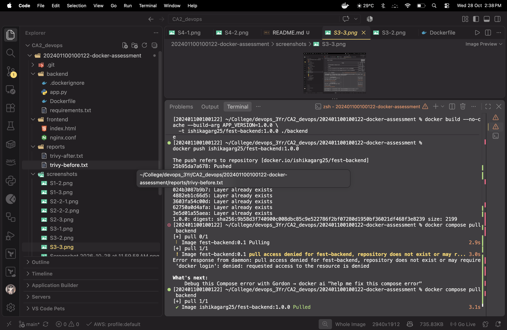
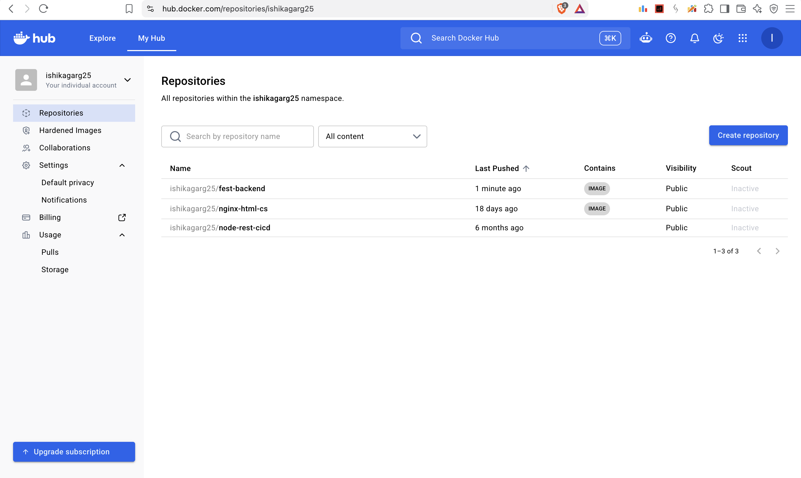
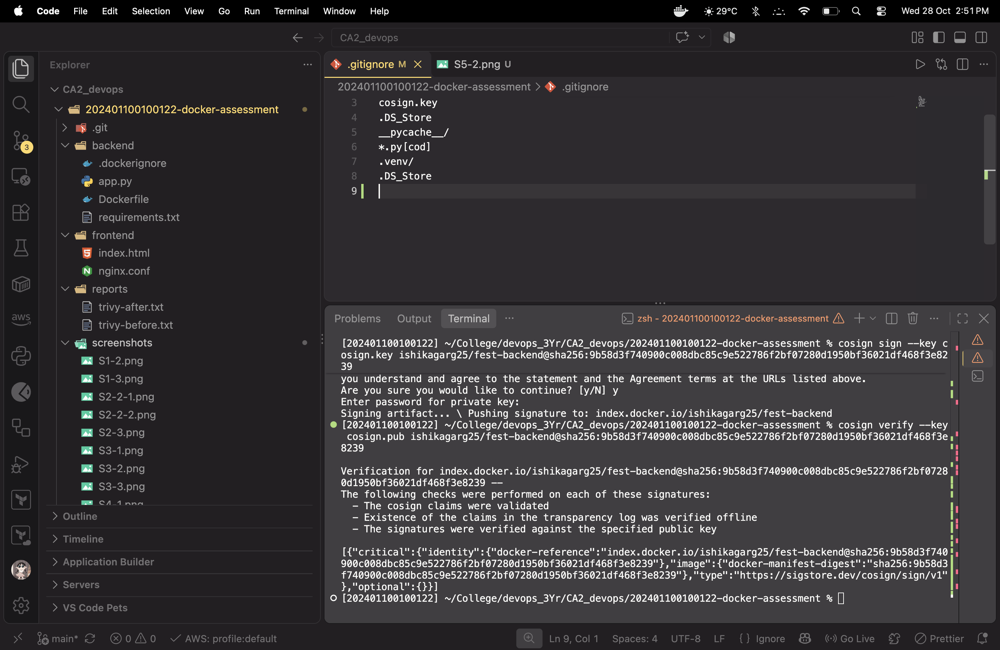
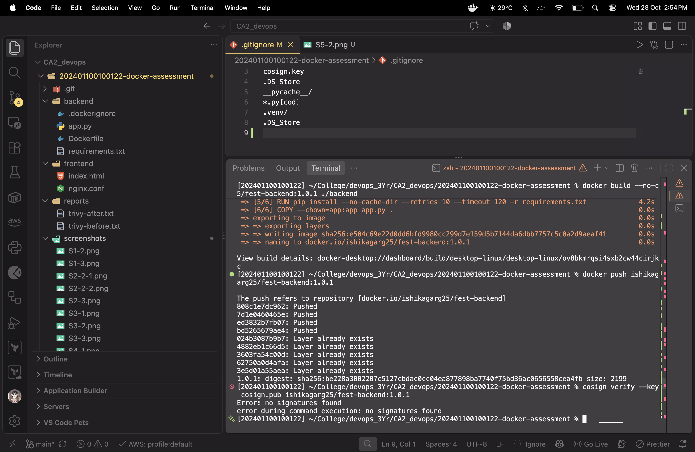

# Docker & Container Security — Practical Assessment

## Student and repository details

- **Name:** Ishika Garg
- **Registration number:** `202401100100122`
- **PORT:** `8080`
- **Docker Hub username:** `ishikagarg25`
- **Docker Hub image:** `https://hub.docker.com/r/ishikagarg25/fest-backend`
- **GitHub repository:** `https://github.com/<YOUR_GITHUB_USERNAME>/202401100100113-docker-assessment`

## What this repository contains

Three-tier FestPass app: Nginx frontend, Flask/Python API, PostgreSQL database. Compose uses an app network for frontend/backend and a separate data network for backend/database. PostgreSQL data is stored in a named volume.

## AI tools

- ChatGPT: used to explain the assessment and help prepare a starter project and command checklist. All commands, scan results, image digests, signatures and screenshots must be generated and checked on my own machine.

## Before-and-after Trivy results

Fill this table only with results from your actual Trivy reports.

| Image              |                CRITICAL |                    HIGH |              Image size | Evidence                   |
| ------------------ | ----------------------: | ----------------------: | ----------------------: | -------------------------- |
| `fest-backend:0.1` | **TODO: actual result** | **TODO: actual result** | **TODO: actual result** | `reports/trivy-before.txt` |
| `fest-backend:0.2` | **TODO: actual result** | **TODO: actual result** | **TODO: actual result** | `reports/trivy-after.txt`  |

## Published image

- `ishikagarg25/fest-backend:1.0.0` digest:
  
- `ishikagarg25/fest-backend:1.0` pushed:
  
- `1.0.0` signature verified:
  
- `1.0.1` unsigned image rejected by `cosign verify`:
  

## Evidence screenshots

Store genuine, unedited screenshots in `screenshots/`. The terminal prompt must show your registration number; browser evidence must show the address bar and Docker Hub username where applicable.

- `S1-2.png`
- `S1-3.png`
- `S2-2.png`
- `S2-3.png`
- `S2-4.png`
- `S3-1.png`
- `S3-3.png`
- `S4-1.png`
- `S4-2.png`
- `S4-3.png`
- `S5-1.png`
- `S5-2.png`
- `S5-3.png`
- `S5-4.png`

## Incomplete steps / issues

Add one honest line for every task you could not complete. Do not claim a scan passed, a digest exists, or an image is signed unless you verified it.
